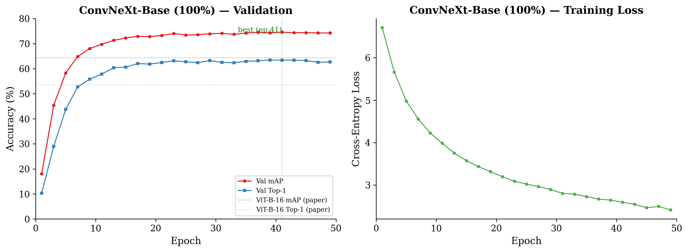

# ConvNeXt-Base (IN-22k to IN-1k) on iNatSounds

This documents the ConvNeXt-Base training runs on the iNaturalist Sounds Dataset (iNatSounds, NeurIPS 2024). Unlike the Swin-V2-B run which used a standalone notebook, we trained ConvNeXt-Base using the original `iNatSounds` repository code with minimal modifications. We conducted two runs: one on 100% of the training data and one using a fresh random 25% subset per epoch (the same subsampling strategy used for Swin-V2-B). Both runs were performed on Thunder Compute instances which caused some trouble due to its cloud infastructure nature that resulted in the loss of the weights for the 100% full run (snapshot failed and the subsequent transfer had the file corrupted) and the retrieval of the training, eval and test log100.txt which has all the results of the test and and also the training history. For the 25% run, the weights were saved and we used them to do the downstream testing on SSW60. For both runs, the code of the original paper's github was used with minor modifications in places to run our choice of models and the percentage of the data that the training saw. 

## Folder Structure

```
.
├── README.md                       # this file
├── models.py                       # modified src/models.py (the only code change)
├── results.json                    # all results in machine-readable format
├── training_log_100pct.txt         # full training log (100% run, 50 epochs, all val + test metrics)
├── training_log_25pct.txt          # 25% run (config + eval results)
└── figures/
    ├── training_curves.png         # val mAP/Top-1 + training loss over 50 epochs (100% run)
    ├── map_vs_params.png           # mAP and Top-1 vs parameter count (all models)
    ├── ranking_divergence.png      # ranking inversion across iNatSounds and SSW60
    └── ssw60_comparison.png        # SSW60 downstream transfer (all models)
```

## Setup

Clone the repository and install dependencies:

```bash
git clone https://github.com/cvl-umass/iNatSounds.git
cd iNatSounds
pip install torch torchvision torchaudio numpy scikit-learn tqdm matplotlib pandas Pillow opencv-python-headless timm
```

## Modifications Made

### models.py

ConvNeXt-Base was added to the `get_model()` function and `hidden_dim_dict` using the `timm` library. This is the only file that differs from the paper's original codebase. The diff is minimal — three additions:

```python
import timm  # added at the top

# added to hidden_dim_dict:
"convnext_base": 1024,

# added elif in get_model():
elif model_name == "convnext_base":
    model = timm.create_model(
        "convnext_base.fb_in22k_ft_in1k",
        pretrained=pretrained,
        num_classes=output_dim,
    )
```

### main.py

In both `run_train` and `run_eval`, the GeoModel instantiation was replaced with:

```python
geo_model = None
```

This disables geographic prior filtering, which requires separate SINR pretrained weights that were not available. Additionally, `latest.pt` is saved every epoch for crash recovery, and `best.pt` is saved when validation mAP improves. No other files were modified.

## Importing the Dataset

The dataset is distributed as a single `spectrograms.tar` archive containing preprocessed mel-spectrogram `.npy` files plus the JSON split files (`train.json`, `val.json`, `test.json`). The `spectrograms.tar` dataset can be shared if appropriate and authorised.

Once the archive is obtained, place it at `~/data/`, extract it, and keep the resulting paths as follows:

In our case, we used `rclone` to download the data to the Thunder Compute instance.

```bash
mkdir -p ~/data
rclone copy gdrive:iNatSounds/spectrograms.tar ~/data/ --progress
cd ~/data && tar -xf spectrograms.tar
```

After extraction, `~/data/` contains the spectrogram directory plus `train.json`, `val.json`, `test.json`.

| Split | Files | Species |
|-------|-------|---------|
| Train | 137,012 | 5,569 |
| Val | 45,698 | 1,212 |
| Test | 49,527 | 1,212 |

The spectrograms were generated by the dataset authors using a Hann window of 512 samples, stride 128, 1024-point FFT, and 128 logarithmically spaced mel bins mapping frequencies in the range 50 Hz–11.025 kHz. Each spectrogram was stored as a uint8 grayscale image and duplicated to 3 channels at load time.

During training, one random 3-second window (512 pixels wide) is sampled per recording per epoch. During evaluation, all 3-second windows (strided by 1.5 seconds) are extracted from each recording and predictions are averaged to produce file-level scores. Predictions are masked to the 1,212 evaluation species.

## Our Choices Compared to the Paper

What remains the same:

- 50 epochs, 5-epoch linear warmup (10% to 100% of LR), then cosine decay to 10% of LR.
- Mixup in log-exp space (exponentiate dB, mix, log back), alpha = 1.0.
- Cross-entropy loss, no label smoothing.
- Frequency masking (15 bins) and time masking (15 bins).
- Sliding-window evaluation with 3-second windows, 1.5-second stride, masked to the 1,212 val/test species.
- Input size: 224 × 224 (same as the paper).
- Batch size: 64 (same as the paper's ViT-B-16 configuration).

Our chosen changes:

- Backbone: ConvNeXt-Base (IN-22k to IN-1k pretrained via `timm`) instead of ViT-B-16 (IN-1k). The IN-22k pretraining provides a substantially richer initialisation than IN-1K alone.
- Optimiser: AdamW (lr=1e-4, wd=0.05) instead of Nesterov SGD (lr=0.05, wd=1e-5). This follows the ConvNeXt training recipe established by Liu et al. (CVPR 2022). The higher weight decay (0.05 vs 1e-5) provides stronger regularisation appropriate for the larger model.
- Per-epoch subsample (25% run only): 25% of the training set, with a fresh random subset every epoch. This is the same strategy used for Swin-V2-B.

## Training Commands

### 100% run

```bash
python main.py \
    --spectrogram_dir ~/data/spectrograms \
    --json_dir ~/data \
    --model convnext_base \
    --optim adamw \
    --lr 1e-4 \
    --wd 0.05 \
    --batch_size 64 \
    --epochs 50 \
    --eval_freq 2 \
    --pretrained \
    --mixup \
    --sound_aug \
    --seed 42 \
    --mode train
```

### 25% run

```bash
python main.py \
    --spectrogram_dir ~/data/spectrograms \
    --json_dir ~/data \
    --model convnext_base \
    --optim adamw \
    --lr 1e-4 \
    --wd 0.05 \
    --batch_size 64 \
    --epochs 50 \
    --eval_freq 2 \
    --pretrained \
    --mixup \
    --sound_aug \
    --seed 42 \
    --data_fraction 0.25 \
    --exp_name 25pct \
    --mode train
```

## Key Hyperparameters

| Parameter | Value |
|-----------|-------|
| Model | ConvNeXt-Base (`convnext_base.fb_in22k_ft_in1k`), ~88.59M params |
| Pretrained weights | ImageNet-22K → ImageNet-1K (timm) |
| Epochs | 50 |
| Batch size | 64 |
| Optimiser | AdamW |
| Learning rate | 1e-4 |
| Weight decay | 0.05 |
| LR schedule | 5-epoch linear warmup (10% to 100%) then cosine annealing to 10% of LR |
| Mixup | Enabled (alpha = 1.0, log-exp space) |
| Sound augmentation | Frequency masking (15 bins) and time masking (15 bins) |
| Image size | 224 × 224 |
| Target length | 512 pixels (~3 seconds at hop = 128, sr = 22050) |
| Test stride | 256 pixels (~1.5 seconds) |
| Per-epoch subsample | 100% (full run) / 25% fresh random subset (25% run) |
| Loss | Cross-entropy (multiclass, soft labels under mixup) |
| Seed | 42 |
| Evaluation masking | Masked to 1,212 val/test species |

## Training Infrastructure

Training was performed on Thunder Compute using a single NVIDIA A100 (80GB) GPU. Training time was approximately 48 hours for the 100% run and approximately 10 hours for the 25% run, both for 50 epochs with validation evaluated every 2 epochs.

## Model Weights

- **100% run**: Best checkpoint was epoch 41 (val mAP 74.62%). Weights were lost due to a Thunder Compute instance failure after training completed. All results are from the training log.
- **25% run**: The epoch 50 checkpoint can be shared if appropriate and authorised.

To evaluate the 25% weights:

```bash
python main.py \
    --spectrogram_dir ~/data/spectrograms \
    --json_dir ~/data \
    --model convnext_base \
    --model_weight ./convnext_epoch50_25pct_run.pt \
    --pretrained \
    --batch_size 64 \
    --seed 42 \
    --exp_name convnext_25pct_eval \
    --mode eval
```

## Results

### 100% run — iNatSounds test set

Test set, sound-averaged, class-averaged metrics, masked to the 1,212 evaluation species, without any geographical-priors. Best validation at epoch 41:

| Metric | Value |
|--------|-------|
| mAP | 74.35% |
| mF1 | 74.93% |
| Top-1 | 62.79% |
| Top-5 | 81.94% |
| ROC-AUC | 99.31% |

On the validation set (epoch 41):

| Metric | Value |
|--------|-------|
| mAP | 74.62% |
| mF1 | 75.42% |
| Top-1 | 63.42% |
| Top-5 | 82.34% |

### 25% run — iNatSounds test set

| Metric | Value |
|--------|-------|
| mAP | 69.50% |
| mF1 | 71.00% |
| Top-1 | 58.50% |
| Top-5 | 79.00% |

### 25% run — SSW60 downstream (no fine-tuning, 1264 recordings)

| Metric | Value |
|--------|-------|
| Top-1 | 70.3% |
| Top-5 | 85.8% |

### Comparison to paper baselines (test set, no geo-priors)

| Model | Params | Top-1 | Top-5 | mAP | mF1 |
|-------|--------|-------|-------|-----|-----|
| MobileNet-V3 (paper) | 6.24M | 49.10 | 69.50 | 60.00 | 63.20 |
| ResNet-50 (paper) | 26.77M | 52.60 | 74.30 | 62.80 | 65.50 |
| ViT-B-16 (paper) | 87.02M | 53.60 | 74.30 | 64.40 | 66.90 |
| ConvNeXt-Base 25%* (ours) | 88.6M | 58.50 | 79.00 | 69.50 | 71.00 |
| **ConvNeXt-Base 100% (ours)** | **88.6M** | **62.79** | **81.94** | **74.35** | **74.93** |

ConvNeXt-Base at 100% outperforms all paper baselines by a wide margin: +9.95 mAP and +9.19 Top-1 over ViT-B-16 at comparable parameter count (~88.6M vs ~87.0M). Even at 25% data per epoch, ConvNeXt substantially exceeds ViT-B-16 at 100%.

### SSW60 downstream comparison

| Model | iNat Data | Top-1 | Top-5 |
|-------|-----------|-------|-------|
| ViT-B-16 (paper) | 100% | 70.9 | 85.8 |
| ConvNeXt-Base (ours) | 25%* | 70.3 | 85.8 |
| EfficientNet-B0 (ours) | 100% | 74.7 | 89.2 |
| **Swin-V2-B (ours)** | **25%*** | **79.8** | **92.2** |

ConvNeXt-Base at 25% matches ViT-B-16 at 100% on SSW60, but Swin-V2-B dominates downstream transfer with 79.8% Top-1 — a +9.5 pp gap over ConvNeXt despite identical parameter count and data strategy. This ranking inversion between iNatSounds and SSW60 is a key finding of our study.

### Training curves



Left: validation mAP and class-averaged Top-1 over 50 epochs, with paper baselines shown as dashed lines. The model surpasses ViT-B-16 mAP by epoch 7. Right: training cross-entropy loss. The loss–metric divergence after epoch 25 (loss continues falling while mAP plateaus) is evidence of weak-label overfitting.

## Output

Weights and logs are saved to:

```
logs/<exp_name>/mixup/pretrained/sound_aug/convnext_base/adamw_b64_lr0.0001_wd0.05/train/0/
```

Checkpoints are saved every 2 epochs to the `checkpoints/` subfolder. The `latest.pt` file is overwritten every epoch for crash recovery, and `best.pt` is saved when validation mAP improves.

## Notes

- Geo-prior evaluation was not performed due to unavailability of SINR model weights.
- Results are from a single seed (seed=42); the paper reports mean ± std across 3 seeds.
- The 100% run weights (`checkpoint_41.pt`, ~354MB) were lost to a Thunder Compute instance failure after training completed. All 100% results come from the training log which was saved before the failure.
- The 25% run uses a fresh random 25% subset per epoch — the same strategy as Swin-V2-B. Over 50 epochs the model sees the full dataset multiple times in expectation.
- ConvNeXt is V1, not V2. The timm model string is `convnext_base.fb_in22k_ft_in1k`.
- The training curve was still improving marginally at epoch 49, but the plateau after epoch 25 suggests most gains have been captured.
