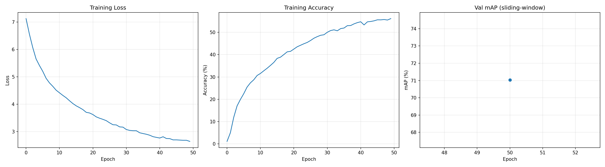

# Swin-V2-B (IN-22k to IN-1k) on iNatSounds

This documents the Swin-V2-B training run on the iNaturalist Sounds Dataset (iNatSounds, 
NeurIPS 2024). Unlike the MobileNet-V3-Large, EfficientNet-B0 and ConvNeXt (IN-22k to 
IN-1k) runs, we conducted the Swin-V2-B training inside a single Jupyter notebook 
meaning that we do not rely on the original `iNatSounds` repository code here. Please 
note that the whole pipeline was run on a Thunder Compute instance due to the 
computational intensity of the task.

## Folder Structure

The folder contains everything needed to reproduce the run, the saved training history, 
and the final results:

```
.
├── README-Swin.md
├── iNatSounds_SwinV2B_Training.ipynb # the training notebook
├── Gdrive_Download_Instructions.txt # instructions for obtaining the spectrograms.tar data
├── swin_v2_b_curves.png # train loss / train acc / val mAP plot
├── swin_v2_b_history.json # per-epoch metrics (loss, acc, lr, val_mAP, etc.)
└── swin_v2_b_results.json # final test-set metrics as well as the configuration used
```

The notebook defines all the code needed to run the training after the data is imported 
(this was done in a virtual instance with a large graphics card given the size of the 
data and the model). This means that we do not use the paper's original repo files such 
as `dataset.py`, `models.py` and `train_eval.py`.

## Importing the Dataset

The first step is to obtain the original iNatSounds data and generate the spectrogram archive. 
The dataset is expected as a single `spectrograms.tar` archive containing preprocessed 
mel-spectrogram `.npy` files plus the JSON split files (`train.json`, `val.json`, 
`test.json`). The `spectrograms.tar` dataset can be shared if appropriate and authorised.

Once the archive is obtained, place it in `~/data/` and extract it:

Once we created an instance on Thunder Compute (which is a cloud machine), we used 
`rclone` within the ubuntu terminal to import that data from Google Drive. Once you have 
SSH'd into the training instance:

```bash
mkdir -p ~/data
rclone copy gdrive:iNatSounds/spectrograms.tar ~/data/ --progress
```

Then extract and delete the original `spectrograms.tar` file:

```bash
cd ~/data && tar -xf spectrograms.tar && rm spectrograms.tar
```

After extracting the data, `~/data/` directory should contain the spectrogram tree plus 
`train.json`, `val.json`, `test.json`. The notebook expects these exact paths by default 
so everything will run (if paths are changed, then path constants in the beginning of 
the `iNatSounds_SwinV2B_Training.ipynb` notebook need to be changed as well).

## Running the Notebook

Once the data is in place, open the Jupyter notebook and the workflow is just:

```bash
pip install torch torchvision timm tqdm scikit-learn matplotlib pandas huggingface_hub safetensors
jupyter notebook iNatSounds_SwinV2B_Training.ipynb
```

Then execute the cells top to bottom. The notebook will:

1. Set the seed to zero, detect the GPU, and print the device summary (if no GPU is 
detected/available some debugging may be needed).
2. Build the dataset, dataloaders, and the per-epoch 25% random subsampler.
3. Start Swin-V2-B from `timm` (`swinv2_base_window12to16_192to256.ms_in22k_ft_in1k`) 
with the 1000-class head replaced by a 5,569-way linear layer. The pretrained weights 
are downloaded automatically by the `timm` package on first run.
4. Run a short sanity check on a mixup batch (expected loss around 
`log(num_classes) = c.8.6`).
5. Train for 50 epochs with AdamW, a 5-epoch linear warmup followed by cosine decay, 
mixup in log-exp space, and frequency / time masking.
6. Evaluate once at the end of training using sliding-window inference (3-second windows, 
1.5-second stride, softmax averaged across windows per recording, logits masked to the 
1,212 evaluation species).
7. Finally, it saves `swin_v2_b_history.json`, `swin_v2_b_results.json`, and 
`swin_v2_b_curves.png`, then prints the comparison table against the paper baselines.

No command-line arguments are needed here, everything is included in the notebook 
(and all parameters are in the configuration cell at the top of the notebook).

## Our Choices Compared to the Paper

What remains the same:

- 50 epochs, 5-epoch linear warmup (10% to 100% of LR), then cosine decay to 10% of LR.
- Single optimizer parameter group, weight decay 1e-5.
- Mixup in log-exp space (exponentiate dB, mix, log back), alpha = 1.0.
- Cross-entropy loss, no label smoothing.
- Frequency masking (15 bins) and time masking (15 bins).
- Sliding-window evaluation with 3-second windows, 1.5-second stride, masked to the 
1,212 val/test species.
- Gradient norm clip set to 100.

Our chosen changes:

- Backbone: Swin-V2-B (IN-22k to IN-1k pretrained) instead of ViT-B-16 (IN-1k).
- Optimizer: AdamW instead of Adam (the paper used Adam for the ViT-B-16 transformer). 
AdamW is the standard recipe for Swin fine-tuning and can sometimes improve training in 
the case of transformers.
- Input size: 256 by 256 because this Swin-V2 variant is locked to that resolution (we 
note that the paper used 224 by 224).
- Per-epoch subsample: 25% of the training set, with a fresh random subset every epoch. 
This is done due to the computational complexity of the task, if we had more time we 
would have done a run where the model sees 100% of the dataset at each epoch.
- Batch size: 64 instead of 128, again to avoid our training crash (more than 48GB of 
VRAM would be needed for batch 128 on a single GPU).

## Key Hyperparameters

| Parameter | Value |
|-----------|-------|
| Model | Swin-V2-B (`swinv2_base_window12to16_192to256.ms_in22k_ft_in1k`), c.92.6M params |
| Pretrained weights | ImageNet-22k to ImageNet-1k (timm) |
| Epochs | 50 |
| Batch size | 64 |
| Optimizer | AdamW |
| Learning rate | 1e-4 |
| Weight decay | 1e-5 |
| LR schedule | 5-epoch linear warmup (10% to 100%) then cosine annealing to 10% of LR |
| Mixup | Enabled (alpha = 1.0, log-exp space) |
| Sound augmentation | Frequency masking (15 bins) and time masking (15 bins) |
| Image size | 256 by 256 |
| Target length | 512 pixels (c.3 seconds at hop = 128, sr = 22050) |
| Test stride | 256 pixels (c.1.5 seconds) |
| Per-epoch subsample | 25% (fresh random subset each epoch) |
| Gradient clip | 100.0 |
| Loss | Cross-entropy (multiclass, soft labels under mixup) |
| Seed | 0 |
| Evaluation masking | Masked to 1,212 val/test species |

## Training Infrastructure

Training was performed on a single NVIDIA RTX A6000 with 48 GB of VRAM. The training time 
for the full 50-epoch run, including the evaluation over the test set, was around 478 
minutes (c.8 hours).

We note that the 48GB VRAM forced us to keep batch size at 64 during training so that we 
would always have enough VRAM and avoid any crash.  

## Model Weights

We provide our trained checkpoint below (epoch 50, used for the reported test numbers):

The Swin-V2-B model weights at epoch 50 can be shared if appropriate and authorised.

These weights can be loaded into the model and then directly used on the test set to 
reproduce our results. Indeed, we use these weights when evaluating Swin-V2-B's 
performance on the SSW60 dataset.

## Results

Test set, sound-averaged, class-averaged metrics, masked to the 1,212 evaluation species, 
without any geographical-priors:

| Metric | Value |
|--------|-------|
| Top-1 | 60.95% |
| Top-5 | 81.42% |
| mAP | 70.29% |
| mF1 | 71.50% |

On the validation set (which was run once at the end of training at epoch 50) we got: 

| Metric | Value |
|--------|-------|
| Top-1 | 61.56% |
| Top-5 | 81.49% |
| mAP | 71.03% |
| mF1 | 72.42% |

### Comparison to paper baselines (test set, no geographical-priors)

| Model | Params | Top-1 | Top-5 | mAP | mF1 |
|-------|--------|-------|-------|-----|-----|
| MobileNet-V3 (paper) | 6.24M | 49.10 | 69.50 | 60.00 | 63.20 |
| ResNet-50 (paper) | 26.77M | 52.60 | 74.30 | 62.80 | 65.50 |
| ViT-B-16 (paper) | 87.02M | 53.60 | 74.30 | 64.40 | 66.90 |
| **Swin-V2-B IN-22k (ours)** | **87.92** | **60.95** | **81.42** | **70.29** | **71.50** |

We see that our Swin-V2-B beats every paper baseline on every metric. Most of the gain 
over ViT-B-16 (which has a similar parameter count) can be attributed to the stronger 
IN-22k pretraining and the architecture through the windowed-attention.

### Training curves
 

 
Left: our training loss across the 50 epochs. Centre: our training accuracy. Right: 
validation mAP (this was only computed once at the end of training at epoch 50 to keep 
computational cost down).

## Output

As mentioned, the notebook outputs three files to its directory at the end of the run:

- `swin_v2_b_history.json`: which saves the per-epoch training loss, training accuracy, 
learning rate, as well as the val metrics recorded at epoch 50.
- `swin_v2_b_results.json`: which saves the final test metrics together with the full 
configuration dictionary that produced them.
- `swin_v2_b_curves.png`: which is a 3-panel plot showing training loss, training 
accuracy, and validation mAP across epochs (which, as mentioned, only has one point).

## Notes

- We note that the geographical-prior evaluation was not performed because we would have 
had to use an additional model (the paper trained a SINR model for this).
- Here our results are from a single seed (seed = 0) whilst the paper reports mean and 
std across 3 seeds.
- The training curve is still decreasing at epoch 50, so a longer run would likely give 
a small additional gain. However, we did not have time to do a longer training run.
- The notebook does not save intermediate checkpoints by default. The shared 
checkpoint is the model state at the end of epoch 50. We have saved weights at epoch 10, 
20, 30, and 40 as well; these intermediate weights can be shared if appropriate and authorised.
